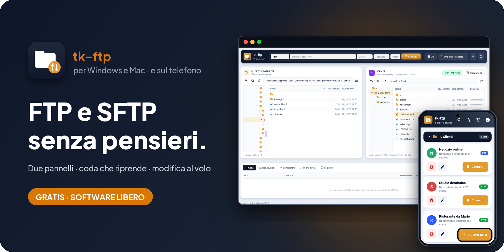
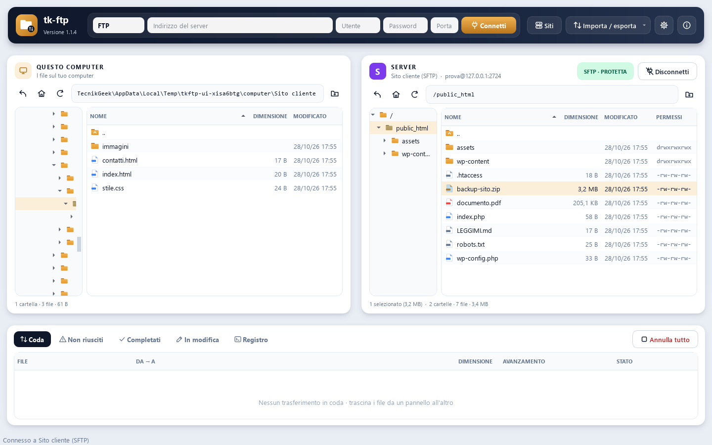

<!-- README generato da Dropbox/CLAUDE/dev/agpl-rollout/readme/genera_readme.py: modificare lì -->
<div align="center">



<br><br>

<a href="https://pietrodefilippis.it/scarica-programma/tk-ftp-desktop/windows/"></a> &nbsp; <a href="https://pietrodefilippis.it/scarica-programma/tk-ftp-desktop/mac/"></a> &nbsp; <a href="https://pietrodefilippis.it/donazione/"></a>

<br><br>

<a href="COPYING"></a>    

<br>

### FTP, FTPS e SFTP senza pensieri. I tuoi file non si rovinano mai.

Il client a due pannelli per chi gestisce siti: trascini, la coda lavora, la modifica al volo carica da sola.

</div>

---

## ✨ Cosa fa

<table>
<tr>
<td width="50%" valign="top">

### 🗂️&nbsp; Due pannelli
Il tuo computer a sinistra, il server a destra: trascini file e cartelle da un lato all'altro.

</td>
<td width="50%" valign="top">

### 🔁&nbsp; Coda che riprende
I trasferimenti interrotti ripartono da dove si erano fermati, senza ricominciare.

</td>
</tr>
<tr>
<td width="50%" valign="top">

### 🛡️&nbsp; File mai rovinati
Ogni file si scrive prima in una copia temporanea: un trasferimento interrotto non tocca mai quello vero.

</td>
<td width="50%" valign="top">

### ✏️&nbsp; Modifica al volo
Apri un file del server nel tuo editor: quando salvi si ricarica da solo, e ti avvisa se nel frattempo è cambiato.

</td>
</tr>
<tr>
<td width="50%" valign="top">

### 🔐&nbsp; Connessioni sicure
FTPS e SFTP con controllo di certificati e chiavi; mai la password in chiaro senza chiedertelo.

</td>
<td width="50%" valign="top">

### 📥&nbsp; Da altri programmi FTP in un clic
Importa i siti salvati in altri programmi FTP e condividili, cifrati, con l'app per il telefono.

</td>
</tr>
</table>

## 🖥️ Com'è fatto

<div align="center">

</div>

## 📱 Anche sul telefono

**tk-ftp** c'è anche per Android, gratis e libera come questo programma:
[tk-ftp-app](https://github.com/tecnikgeek-repo/tk-ftp-app).

<a href="https://github.com/tecnikgeek-repo/tk-ftp-app"></a>

## 🔒 I tuoi dati

Le password dei siti stanno nel portachiavi del sistema (Gestione credenziali di Windows o Portachiavi del Mac), mai in chiaro su disco. Nessun server dell'autore vede i tuoi siti o i tuoi file.

| Resta sul tuo computer | Va in rete (e perché) |
|---|---|
| I tuoi siti, utenti e impostazioni | I server FTP/SFTP a cui ti colleghi tu |
| Le password, nel portachiavi del sistema | Controllo degli aggiornamenti su pietrodefilippis.it |
| Le copie dei file in modifica | Statistiche anonime, solo se le accetti |

Nessuna pubblicità, nessun account da creare. Le statistiche anonime partono **solo se le accetti** al primo avvio
(si cambiano quando vuoi). Gli aggiornamenti sono **firmati digitalmente**: il programma installa solo quelli
pubblicati dall'autore.

## 📥 Installazione

- **Windows 10 / 11** — scarica l'installer `.exe` e avvialo. Non servono i permessi di amministratore.
- **macOS** (Intel o Apple Silicon) — apri il `.dmg` e trascina l'app in *Applicazioni*. Al primo avvio: clic destro sull'app → *Apri*.
- **Portatile** — la versione ZIP gira anche da una chiavetta USB.

Gli aggiornamenti arrivano da soli: quando esce una versione nuova il programma te lo propone.

<details>
<summary><b>🛠️ Avviarlo dal codice sorgente</b></summary>

<br>

Serve **Python 3.11** o più recente.

```bash
python -m venv .venv
.venv\Scripts\pip install -r requirements.txt
.venv\Scripts\python run.py
```

Su macOS: `.venv/bin/pip install -r requirements.txt`, poi `.venv/bin/python run.py`.

Collaudi con server FTP, FTPS e SFTP di prova in locale (nessuna rete esterna): `python tests/test_core.py` e `python tests/test_sicurezza.py`.
Pacchetti: `installer\build.ps1` (Windows), `mac/build_mac.sh` (macOS).

</details>

## 📜 Licenza

**tk-ftp** è software libero: © 2026 Pietro De Filippis (TecnikGeek), licenza
**[GNU Affero General Public License v3.0](COPYING)** o successiva. Puoi usarlo, studiarlo, modificarlo e
condividerlo; è fornito **così com'è, senza alcuna garanzia**. I testi delle licenze dei componenti inclusi
(paramiko, Qt/PySide6, Python, cryptography, certifi) sono nella cartella [`licenze/`](licenze/) e nel programma, in *Informazioni → Licenze e codice
sorgente*.

> Il nome **tk-ftp** e il logo non sono coperti dalla licenza (AGPL, sezione 7): una versione modificata deve
> avere un nome e un logo diversi.

---

<div align="center">

**Ti è utile?** Tutte le funzioni sono gratis per tutti. Se vuoi, un caffè aiuta a migliorarlo e a crearne altri.

<a href="https://pietrodefilippis.it/donazione/"></a>

<sub>Creato da <a href="https://pietrodefilippis.it">Pietro De Filippis · TecnikGeek</a> — Webmaster & UX/UI Designer</sub>

</div>
